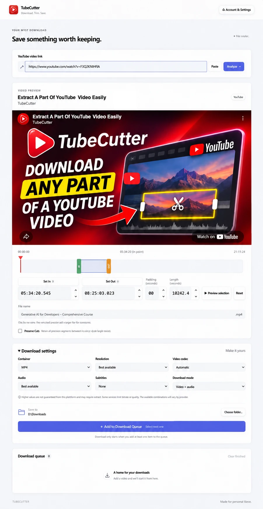

<!-- languages:start -->

<b>🌐 Language · Idioma · Langue · Sprache · Язык · 语言 · 言語 · 언어 · भाषा · لغة</b>

 

<table>
  <tr>
    <td align="center"><a href="../../README.md">English</a></td>
    <td align="center"><a href="README.ar.md">العربية</a></td>
    <td align="center"><a href="README.bn.md">বাংলা</a></td>
    <td align="center"><a href="README.zh-Hans.md">简体中文</a></td>
    <td align="center"><a href="README.fil.md">Filipino</a></td>
  </tr>
  <tr>
    <td align="center"><a href="README.fr.md">Français</a></td>
    <td align="center"><a href="README.de.md">Deutsch</a></td>
    <td align="center"><a href="README.hi.md">हिन्दी</a></td>
    <td align="center"><a href="README.id.md">Bahasa Indonesia</a></td>
    <td align="center"><a href="README.it.md">Italiano</a></td>
  </tr>
  <tr>
    <td align="center"><a href="README.ja.md">日本語</a></td>
    <td align="center"><a href="README.ko.md">한국어</a></td>
    <td align="center"><a href="README.fa.md">فارسی</a></td>
    <td align="center"><a href="README.pt-BR.md">Português (Brasil)</a></td>
    <td align="center"><a href="README.ru.md">Русский</a></td>
  </tr>
  <tr>
    <td align="center"><a href="README.es.md">Español</a></td>
    <td align="center"><a href="README.te.md">తెలుగు</a></td>
    <td align="center"><a href="README.th.md">ไทย</a></td>
    <td align="center"><a href="README.tr.md">Türkçe</a></td>
    <td align="center"><b>Tiếng Việt</b></td>
  </tr>
</table>

<!-- languages:end -->

# TubeCutter

**Đừng tải cả video nữa. Chỉ lấy khoảnh khắc bạn muốn.**

TubeCutter là cách nhanh nhất để lưu đúng phần video YouTube bạn cần. Dán liên kết, xem trước, kéo để đánh dấu điểm vào và điểm ra, và TubeCutter sẽ cắt đúng đoạn đó thành một tệp gọn gàng. Xếp hàng bao nhiêu clip tùy thích, tạm dừng hoặc hủy bất cứ lúc nào, và giữ lại những clip bạn yêu thích. Dành cho Windows và Mac.

  

**Tình trạng bản phát hành hiện tại:** trình cài đặt Windows x64 được đăng trong [bản phát hành v0.1.1](https://github.com/MolecularDust/TubeCutter/releases/tag/v0.1.1). Nó chưa được ký mã, nên Windows SmartScreen có thể cảnh báo ở lần chạy đầu tiên. Các tệp `.app` và `.dmg` macOS cho Apple Silicon là bản dựng đánh giá cục bộ hoạt động được. Các thử nghiệm siêu dữ liệu/tải xuống của công cụ đã ký và kiểm tra tính toàn vẹn chữ ký/ảnh đều đạt. Ngoại lệ xác thực thư viện do người dùng phê duyệt chỉ áp dụng cho yt-dlp; ứng dụng chính vẫn giữ xác thực và Deno chạy khi tắt JIT. Xem [chi tiết về chữ ký](../SIGNING_APPROVAL.md). Bản dựng được ký ad hoc, không ký bằng Developer ID và chưa được công chứng.

## Tải xuống

- **Windows:** [Tải bản phát hành mới nhất](https://github.com/MolecularDust/TubeCutter/releases/latest). Chọn cài đặt thông thường hoặc bản di động.
- **macOS:** [Tải bản phát hành mới nhất](https://github.com/MolecularDust/TubeCutter/releases/latest).

## Thiết lập quyền truy cập YouTube

1. Cài TubeCutter và mở **Tài khoản & Cài đặt**.
2. Trong menu **Xác thực**, chọn **Phiên YouTube của ứng dụng**.
3. Nhấp **Đăng nhập Google** và hoàn tất đăng nhập.

Bạn đã sẵn sàng dùng TubeCutter.

Để dùng trình duyệt bạn đã đăng nhập sẵn, hãy chọn Chrome, Firefox hoặc Opera trong **Xác thực**. Trên Windows, đóng trình duyệt đó trước khi bắt đầu. Chỉ dùng tài khoản của chính bạn. Đừng nhập hay chia sẻ cookie của người khác.

Bạn cũng có thể giữ **Ẩn danh**, nhưng kiểm tra chống bot của Google nghiêm ngặt hơn với truy cập ẩn danh.

## Sử dụng

1. Chọn thư mục đích bằng bộ chọn gốc.
2. Dán liên kết YouTube (watch, youtu.be hoặc Shorts) và nhấp Phân tích.
3. Dùng trình phát YouTube toàn chiều rộng. Các nút điều khiển gốc của nó lo việc phát và âm lượng.
4. Dòng thời gian tự bật sau khi phân tích. Giữ nguyên Vào/Ra để tải toàn bộ video; đổi một trong hai điểm sẽ chọn một đoạn cắt. Đặt lại khôi phục toàn bộ video. Kéo Vào/Ra, sửa HH:MM:SS(.mmm) hoặc dùng Đặt điểm vào/Đặt điểm ra. I/O hoạt động ngoài các ô nhập; phím Cách bật/tắt phát. Kéo tam giác đỏ phía trên đường để di chuyển đầu phát độc lập với Vào/Ra. Phím mũi tên dịch một điểm đánh dấu hoặc đầu phát đang chọn 0,1 giây, Shift+mũi tên 1 giây; Home/End đưa đầu phát đến biên của video.
5. Đệm mặc định 00 giây và nới rộng mỗi đầu, dừng ở biên video. Độ dài hiển thị thời lượng sau khi đệm. Vào, Ra, Đệm và Độ dài có nút lên/xuống một giây; nút của Độ dài điều chỉnh Ra. Xem trước đoạn chọn phát khoảng đã đệm và thành Dừng khi đang phát. Chọn cắt nhanh hoặc Cắt chính xác.
6. Cài đặt tải xuống ban đầu mở sẵn; nhấp vào tiêu đề để thu gọn hoặc mở lại. Chọn định dạng chứa, độ phân giải nguồn thực tế, codec, âm thanh, phụ đề và chế độ, rồi thêm vào hàng chờ.
7. Tạm dừng (Tạm dừng/Tiếp tục) hoặc hủy (Hủy) các lượt tải đang chạy. Thử lại những lượt thất bại (Thử lại) và hiện tệp đã xong (Hiện trong Finder). Xóa mục đã xong xóa các dòng đã xong, đã hủy và thất bại, đồng thời giữ lại các tác vụ đang chạy và tệp đã lưu.

**Tài khoản & Cài đặt** mặc định là ẩn danh. **Đăng nhập Google** / **Kết nối YouTube** mở các trang của chính Google trong một cửa sổ ứng dụng, phiên đăng nhập được giữ trong bộ nhớ web của ứng dụng; sau đó chọn _Phiên YouTube của ứng dụng_ sẽ cho yt-dlp một bản chụp cookie riêng cho mỗi tác vụ (chế độ 0600, xóa sau khi xong và dọn khi khởi động), không truy cập trình duyệt hay Chuỗi khóa.

Chọn một trình duyệt là cho phép rõ ràng việc truy cập cookie của nó sau đó và có thể kích hoạt các yêu cầu quyền của hệ điều hành. Đừng nhập hay chia sẻ cookie của người khác. Chỉ đường dẫn và tùy chọn được lưu trong thư mục cấu hình của ứng dụng. Xác thực là tùy chọn.

## Ngôn ngữ

Giao diện ứng dụng có tiếng Anh và 19 ngôn ngữ khác: Ả Rập, Bengal, Trung (giản thể), Filipino, Pháp, Đức, Hindi, Indonesia, Ý, Nhật, Hàn, Ba Tư, Bồ Đào Nha (Brazil), Nga, Tây Ban Nha, Telugu, Thái, Thổ Nhĩ Kỳ và Việt. Mặc định theo ngôn ngữ hệ thống. Để chọn ngôn ngữ khác, mở **Tài khoản & Cài đặt → Ngôn ngữ**; lựa chọn có hiệu lực ngay và được ghi nhớ. Tiếng Ả Rập và tiếng Ba Tư hiển thị từ phải sang trái. Các trang của trình cài đặt macOS cũng theo ngôn ngữ của máy Mac.

## Phát triển

Ghi chú xây dựng chỉ có tiếng Anh: xem [README tiếng Anh](../../README.md#development).
